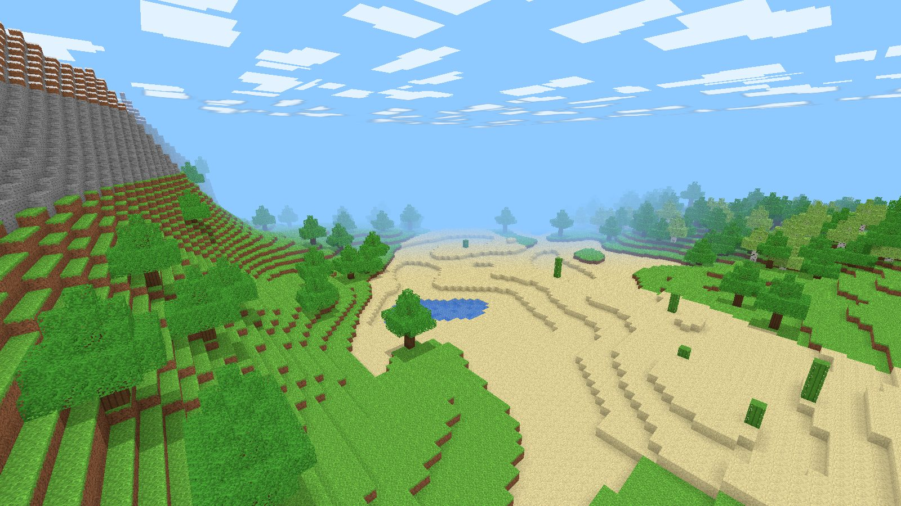

# Voxelia

Juego de mundo abierto de bloques para PC, con su propio **launcher**. Todo el contenido es original: las texturas y los sonidos se generan por código (no usa archivos ni marcas de otros juegos).



## Qué incluye

**Launcher (app de escritorio)**
- Perfil del jugador (nombre).
- Mis mundos: crear (nombre, semilla, modo), jugar y eliminar, con una foto de cada mundo, la última vez jugada y el tiempo total.
- Novedades y ajustes: distancia de renderizado, campo de visión, sensibilidad, volumen, música, minimapa, pantalla completa y FPS.
- Botón **JUGAR**: abre el juego en su ventana. Al salir vuelve al launcher.
- Los mundos se guardan como archivos en la carpeta de datos del usuario (en Windows, `%APPDATA%\Voxelia`).

**Juego**
- **Mundo infinito** generado a partir de una semilla:
  - biomas: llanuras, bosque, desierto, nieve y montañas;
  - árboles (roble y abedul), cactus, playas, lagos y mar;
  - cuevas con carbón y hierro.
- **Más de 25 bloques** para construir: madera, piedra, vidrio, ladrillo, lana, lámparas, antorchas y más.
- **Iluminación real**: lámparas, antorchas, cristales y faros iluminan a su alrededor con luz cálida, y la luz no atraviesa paredes. Bajo tierra está oscuro de verdad.
- **Minimapa y mapa** (M) de lo explorado, con tus faros y el punto de reaparición.
- **Lanudos**: animales pacíficos de pelaje pastel que pastan de día, huyen si les pegás y sueltan lana.
- **Música ambiental** generada en el momento: luminosa de día, más grave de noche y bajo tierra.
- **Modo Creativo**: bloques infinitos y vuelo (doble espacio o F).
- **Modo Supervivencia**: romper lleva tiempo según el bloque, lo que rompés va al inventario, hay vida con daño por caída, aire bajo el agua y reaparición. Ver abajo lo que lo hace distinto.
- **Ciclo de día y noche** con sol, luna, estrellas y nubes. Hay oclusión ambiental y sombras bajo techos y árboles, niebla a distancia y vista bajo el agua.
- **Movimiento**: gravedad, saltos con margen, colisiones, nado, correr y agacharse (Shift, sin caerte de los bordes). La cámara se balancea al caminar, abre el campo de visión al correr y se hunde al aterrizar.
- **Mano en primera persona**: ves lo que tenés agarrado (bloques, antorchas, herramientas en relieve) con animación al golpear, al caminar y al cambiar de ítem.
- **Partículas y sonido**: partículas al romper y sonidos sintetizados al romper, colocar y caminar.
- **Interfaz**: barra rápida, inventario (E), menú de pausa con opciones y controles, e información de depuración (F3).
- **Guardado** automático cada 30 s y al salir.

## Supervivencia: qué tiene de distinto

- **Taller (C) y Mesa de trabajo**: no hay grillas ni recetas para memorizar. El Taller muestra todo por categorías, con lo que tenés y lo que falta, y fabricás con un clic (o "Fabricar todo"). A mano se hacen las cosas básicas; con una Mesa de trabajo cerca (clic derecho sobre ella) se desbloquean herramientas, armas y mejoras.
- **Herramientas por nivel**: picos, hachas, palas y espadas de madera, piedra, hierro y **cristal** (la más rápida, brilla en la mano). Cada una acelera su tipo de bloque, pega más fuerte y se gasta con el uso (barra de durabilidad).
- **Energía en lugar de hambre**: correr y saltar gastan energía, y se recupera sola al caminar o quedarte quieto. No hay que andar buscando comida.
- **Sombras**: criaturas nocturnas que flotan hacia vos y le temen a la luz. Cerca de lámparas, cristales o faros se queman y huyen. De día se disuelven. Al vencerlas sueltan **esencia**. Cada noche que sobrevivís aparecen algunas más.
- **Cristales**: brillan en las cuevas profundas (por debajo de la altura 20). Iluminan y sirven para fabricar.
- **Faro**: marca tu punto de reaparición y proyecta un haz de luz visible desde lejos para volver a casa.
- **Planeador**: se fabrica con esencia. Mantené espacio en el aire para planear sin daño por caída.
- **Corazones extra**: con esencia y cristal subís la vida máxima, hasta 15 corazones.
- **Misiones guiadas**: 10 objetivos que te enseñan a jugar, desde juntar madera hasta fabricar el planeador.
- **Antorchas**: carbón + tablas = 4 antorchas, la forma barata de mantener lejos a las Sombras.
- **Contador de días y lluvia**: el clima cambia y la lluvia oscurece el día.

## Aldeas y aldeanos

- **Aldeas generadas** según el bioma: **medievales** en la llanura (casas de piedra y madera con techos de tejas, torre de vigilancia con almenas), **del bosque** (techos de paja), **del desierto** (adobe y techos planos) y **de la nieve** (troncos y techos nevados). Tienen plaza con pozo, caminos, faroles y chimeneas que echan humo. Siempre hay una cerca del inicio y aparecen en el mapa (M).
- **Aldeanos con personalidad**: nombre, oficio (constructor, guardia, granjero, herrero, mercader) y carácter (valiente, tímido, charlatán, gruñón, alegre, trabajador). Pasean, charlan entre ellos con globitos de diálogo, te saludan y te miran cuando pasás. La ropa cambia con el estilo de la aldea.
- **De noche se esconden** en sus casas (los tímidos, antes; los valientes, último). Los **guardias** salen a patrullar con antorchas y pelean contra los zombis.
- **La población crece**: cada mañana puede nacer alguien si hay lugar, y los chicos crecen y eligen el oficio que falta. Cuando la aldea se llena, el **constructor levanta una casa nueva bloque por bloque** (se lo ve trabajar). Si le donás materiales, termina más rápido.
- **Trueques** con clic derecho: tejas, paja y adobe del constructor; flechas, arco y escudo del guardia; el **herrero repara** tu herramienta; el mercader del desierto cambia esencia por cristales. Ayudar a la aldea (trueques, donaciones, matar zombis cerca) mejora tu reputación; pegarles a los aldeanos la empeora.
- **Zombis** de noche: caminan con los brazos estirados y persiguen al jugador y a los aldeanos que quedaron afuera. Al amanecer **buscan sombra para esconderse** y, si el sol los agarra, se queman.
- **Arco y flechas** (clic derecho) y **escudo** (en la mano, los golpes sacan 60% menos).

## Reino, comercio y equipo (0.6)

- **Rey o reina** en las aldeas medievales, que viven en un **castillo** con sala del trono, estandartes y torrecitas; en las otras aldeas manda un **jefe o jefa**. Dan **encargos** (llevar pan, adoquines, lana o hierro, o eliminar zombis de noche) que pagan en plata y suben tu rango: Plebeyo, Escudero, Caballero, Noble y Héroe del reino.
- **Monedas de plata**: cada oficio vende cosas propias y compra lo que necesita (el herrero forja armaduras, el guardia vende arco, flechas y escudo, el granjero comida y semillas, el constructor puertas, ventanas y camas, el leñador madera). Los zombis a veces sueltan plata. Algunas cosas solo se venden cuando la aldea crece (Aldea → Pueblo → Ciudad).
- **Mercado**: puestos con toldo a rayas en la plaza, atendidos de mañana.
- **Armadura** acolchada (lana), de hierro y de cristal: casco, pechera, pantalones y botas. Cada punto frena 4% del daño (hasta 80%) y las piezas se gastan. Se equipa desde el inventario (E).
- **Escudo**: equipalo en la mano izquierda (E) y mantené **clic derecho** (con una herramienta o la mano vacía) o **V** para cubrirte: frena los golpes de frente, pero caminás más lento.
- **Comida**: manzanas (de las hojas), trigo, pan y pastel. Clic derecho para comer: cura corazones y devuelve energía.
- **Campo**: la pala ara el pasto (clic derecho) y las semillas se siembran en la tierra arada; el trigo madura con el tiempo. Las aldeas tienen campos con riego que los granjeros cosechan.
- **Camas, puertas y ventanas**: dormir de noche pasa a la mañana y deja tu punto de reaparición en la cama; las puertas se abren con clic derecho y **los zombis no saben abrirlas**.
- **Aldeanos más vivos**: tienen hambre, sueño y ganas de charlar (su ánimo se ve al hablarles), siguen un horario (trabajan, almuerzan en el mercado, charlan, vuelven a casa, abren y cierran la puerta y **duermen en su cama**), forman **parejas** y tienen **hijos** si hay camas libres y comida. Los granjeros cosechan, los leñadores talan y el constructor gasta madera y piedra de las **reservas de la aldea** (si faltan, la obra se frena hasta que dones materiales).

## Profundidades y saqueadores (0.7)

- **Generador de cuevas** nuevo: además de los túneles, hay **cavernas** enormes en lo profundo, **grietas** que abren la superficie (entradas naturales) y **lagos de lava** en el fondo, que iluminan y queman (en la lava se nada lento). El suelo de las cuevas tiene **musgo** y **hongos luminosos** que alumbran; más abajo aparece **oro**, que vale mucho en las aldeas.
- **Campamentos de saqueadores**, las aldeas malas: empalizada de troncos con portones, carpas negras y rojas, fogata, torre de vigilancia, bandera, **jaulas con prisioneros** y el **cofre del botín**. Hay uno a una caminata del inicio y se ven en rojo en el mapa.
- **Saqueadores** con pañuelo rojo y máscara, **arqueros** que disparan flechas (el escudo las frena) y un **jefe** con barra de vida. Si golpeás a uno, se enoja todo el campamento. Al derrotar al jefe, el campamento queda libre y el resto huye.
- **Prisioneros**: rompé los barrotes de una jaula y el prisionero se muda a la aldea buena más cercana (más población y reputación).
- **Incursiones**: algunas noches, un grupo de saqueadores ataca una aldea cercana: van contra los aldeanos que quedaron afuera y se roban la comida de la plaza. Los guardias pelean y al amanecer se retiran.
- **Inventario con tu personaje**: modelo 3D con la armadura, el escudo y lo que tenés en la mano, que **sigue al cursor** con la mirada.

## Hogar (0.8)

- **Herramientas y materiales rediseñados**: todos los íconos son pixel-art de 32×32 dibujado por código, con contorno, sombra y brillo. Cada nivel tiene su material (madera veteada, piedra, hierro pulido, cristal translúcido con destellos); los lingotes y el carbón tienen volumen, la moneda tiene un sello, y la comida se ve apetitosa. En la mano se ven en 3D, sin el contorno.
- **Casas amuebladas** en tres tipos: **familiar** (mesa con sillas, alfombra, biblioteca), **taller** (yunque, barriles, mesa de trabajo) y **granja** (fardos de heno, barril, mesa). Todas tienen camas, un **hogar a leña** que ilumina y una **chimenea** justo encima (el humo sale de ahí), y flores en la entrada. El castillo tiene **trono** y bibliotecas; los puestos del mercado muestran mercadería.
- **Muebles nuevos** que se fabrican en la pestaña **Muebles** del Taller: mesa, sillas (el respaldo se acomoda solo mirando a la mesa o contra la pared), biblioteca, hogar a leña (el fuego da hacia el lado libre), alfombras, barril, fardo de heno, yunque y trono. También hay **flores silvestres** en llanuras y bosques.
- **Aldeanos en casa**: de noche, antes de dormir, se **sientan a cenar** a la mesa.

## Mares y vida (0.9)

- **Océanos** con arrecifes de coral, algas y pastos marinos; cardúmenes de peces, medusas que brillan de noche y bandadas de pájaros.
- **Biomas con más vida**: pinos (nevados en la montaña), robles grandes, palmeras en las playas, troncos caídos, arbustos de bayas, pasto alto y flores.
- **Animales**: ciervos (bosque), conejos (praderas y nieve) y cangrejos (playa), además de los Lanudos. Dejan carne.
- **Puertos**: las aldeas de la costa tienen muelle, faro, pescadores y marineros. Llegan **barcos mercantes** que traen comida y materiales y bajan el precio de gemas, metales y lana por dos días.
- **Botes**: Taller → 5 tablas. Clic derecho sobre el agua para ponerlo, clic derecho al bote para subir; W/S reman, A/D giran, Shift para bajar; golpealo para guardarlo.
- **Barcos hundidos** en el fondo del mar, con un cofre de perlas, oro y plata.
- **Economía local**: cada aldea tiene sus propios precios según el bioma, sus reservas y si es puerto (▲ caro / ▼ barato en la tienda).
- Nota: el generador de terreno cambió; en mundos guardados de versiones anteriores las zonas nuevas pueden quedar con mares.

## Vida de pueblo (0.10)

- **Iglesia** con campanario, campana, vitrales, altar y bancos. La atiende un sacerdote o sacerdotisa; a la tarde suena la campana y los vecinos van a misa.
- **Escuela** con pupitres y pizarrón: a la mañana los chicos van a clase con el maestro o la maestra. Los que estudian terminan la escuela sabiendo leer y escribir.
- **Corral** con cerca, comedero y heno: lanudos, gallinas y un caballo. El granjero les da de comer y la aldea suma comida y lana.
- **Caballos**: en las praderas y en los corrales. Clic derecho para montar (corre el doble), Shift para bajar.
- **Caminos** de grava con faroles entre aldeas vecinas, con puentes de madera sobre el agua.
- **Carretas de comercio**: van por los caminos llevando lo que le sobra a un pueblo y le falta a otro; el que recibe le paga en plata al tesoro del que manda.
- **Plata entre vecinos**: cada aldeano tiene su bolsa, cobra su jornal y compra en el mercado (pagándole al que atiende el puesto). El rey o el jefe cobra impuestos, paga a guardias y docentes y compra materiales para las obras.
- Bloques nuevos: cerca, campana, banco de iglesia, altar, pizarrón, vitral y comedero.
- **Guardias con espada y escudo**, con un algoritmo de combate propio (`guards.js`):
  - evalúan las amenazas (peligro de cada enemigo, cercanía a los vecinos y al jugador, vida que le queda);
  - se reparten los enemigos sin amontonarse (al jefe lo rodean hasta 3, a un zombi o arquero va 1) y cada uno toma un lado;
  - leen cuándo el enemigo va a pegar, levantan el escudo justo a tiempo (frena el 88 % de frente, y a veces empujan con el escudo) y contraatacan con un golpe fuerte;
  - cada tercer tajo es pesado y empuja; contra arqueros cargan en zigzag cubiertos;
  - si quedan muy heridos y hay otro peleando, se repliegan a la plaza a curarse y vuelven;
  - dan la alarma al empezar y festejan al ganar; de día hacen guardia en la plaza y de noche hacen la ronda con antorcha.

## 0.11 a 0.17

- **Base (0.11):** las mallas del mundo se arman en *workers* (sin tirones) y los personajes buscan caminos con A* (rodean casas, usan puertas, no se meten al agua).
- **Sensaciones (0.12):** tormentas con rayos y truenos, nieve en el frío, auroras, luna con fases, estrellas fugaces, sonido ambiente (viento, olas, pájaros, grillos, mercado) y música por zona.
- **Supervivencia (0.13):** hambre (10 muslitos), cocina en fogata/hogar/horno, pesca con caña (salmón, pez dorado…), zanahorias, papas, calabazas, manzanos, colmenas con miel y refuerzos del herrero hasta +3.
- **Exploración (0.14):** pantanos, selvas y cañones; ruinas (torre, templo, mina) con cofres y mapas del tesoro; lobos (se domestican con carne), loros, serpiente marina, dragón en su guarida y tormentas que dan vuelta el bote.
- **Pueblos vivos (0.15):** panadero, médico, cartógrafo y bibliotecario; encargos de cada vecino; memoria y chismes; aldeas aliadas y rivales (refuerzos); fiestas, casamientos, sucesión del rey; diario de viaje (J).
- **Combate y objetivos (0.16):** golpe cargado, desvío con escudo, escuderos y lanzadores de bombas, amenaza creciente, señorío, casa propia y mazmorras con el Rey Sombrío (tres fases).
- **Presentación (0.17):** tutorial, logros, dificultad, teclas configurables, tamaño de interfaz, modo daltónico, tercera persona (F5), arena que cae, árboles que caen, agua que corre, aviso de actualización y copias de seguridad automáticas en el launcher.

## Controles

| Tecla | Acción |
|---|---|
| W A S D | Moverse |
| Espacio | Saltar / nadar · doble espacio o F: volar (creativo) |
| Shift | Agacharse · bajar al volar |
| Ctrl o R | Correr |
| Clic izquierdo / derecho | Romper / colocar bloque |
| Rueda o 1-9 | Elegir bloque |
| Clic de rueda | Copiar el bloque apuntado (creativo) |
| E | Inventario |
| C | Taller (supervivencia) |
| Clic derecho en la Mesa | Taller completo |
| M | Mapa |
| Clic derecho a un aldeano | Hablar y hacer trueques |
| Clic derecho con el arco | Disparar |
| Clic derecho sostenido o V | Cubrirse con el escudo |
| Clic derecho con comida | Comer |
| Clic derecho en cama o puerta | Dormir / abrir y cerrar |
| Espacio en el aire | Planear (con planeador) |
| F3 | Depuración |
| Esc | Pausa |

## Desarrollo

Requiere Node.js 22.

```bash
cd voxelia
npm install
npm start            # compila el juego y abre el launcher (Electron)
npm run dev          # solo el juego en el navegador: http://localhost:5180
npm test             # generación del mundo, física, guardado
```

## Instalador para Windows

- **Automático (recomendado):** cada cambio en `voxelia/` que llega a `main` dispara el workflow `.github/workflows/voxelia.yml`, que arma el instalador en una máquina Windows. Se descarga desde GitHub → **Actions** → *Voxelia · instalador Windows* → la última corrida → **Artifacts** → `Voxelia-Windows`.
- **Release pública (link permanente, sin cuenta):** cuando llega a `main` una versión nueva de `package.json`, el workflow publica la Release `voxelia-vX.Y.Z` con el `.exe`. Se descarga desde GitHub → **Releases**. Para sacar otra, subí `version` en `package.json`.
- **A mano en Windows:** `npm install && npm run dist:win` deja `release/Voxelia-Setup-0.2.0.exe` y una versión portable `.zip`.

El instalador no está firmado digitalmente, así que Windows SmartScreen puede mostrar "Windows protegió su PC". Se sigue con **Más información → Ejecutar de todas formas**. Para distribuirlo al público conviene un certificado de firma de código.

## Estructura

```
launcher/   main.cjs (Electron: ventanas y guardado) · preload.cjs (puente seguro) · index.html/css/js (interfaz)
game/       index.html · src/ (world, mesher, textures, player, sky, audio, ui, game) · test/
build/      icon.png
```

## Próximos pasos posibles

Más animales y biomas, cofres, mascotas, multijugador en red local, mods y paquetes de texturas, y actualizaciones automáticas desde el launcher.
